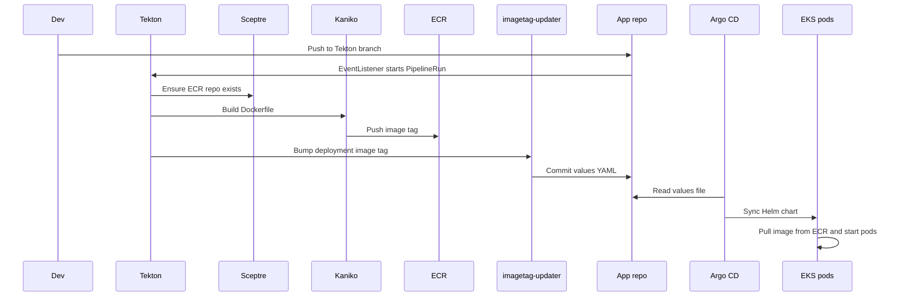

# How a deploy works

High-level path after migration (from [README](../README.md) and wiplatform rollout). Glossary: [glossary.md](glossary.md).

---

## Build and deploy sequence

On a **first migration**, the workload **Argo** app may stay `disable: true` until a real image tag and **Secrets Manager** keys exist — Tekton can still build. See [docs/03-platform.md](../docs/03-platform.md).

---

## Where configuration comes from

| Kind | Where it lives | Who sets values |
| --- | --- | --- |
| Plain runtime env | `deployment.env.config` in values YAML | Dev in git |
| Secrets | AWS **Secrets Manager** | Dev (CPS); key **names** only in git |
| Secret sync | **ExternalSecret** in cluster | Chart reads SM by path |
| Browser / build-time | **NEXT_PUBLIC_** via Tekton `buildargs` and matching Dockerfile `ARG`s | Dev in values; Kaniko passes args at image build |
| Image version | `deployment.image.tag` in values YAML | **imagetag-updater** or manual PR |

Never commit secret values to git.

---

## When it breaks, look here

| Symptom | Where to look first |
| --- | --- |
| Kaniko push denied or wrong repo | `tekton.sceptrecommands` ServiceName vs `deployment.image.repository`; [gotchas](../docs/gotchas.md) ECR naming |
| PipelineRun never starts | Tekton app not `disable: false`; wrong env `pipelines.yaml` (INT vs PROD); `eventListener.mode` not `shared`; branch mismatch with `tekton.branch`; or missing catalog entry — see [03-platform](../docs/03-platform.md) |
| ImagePullBackOff | Tag still `bootstrap-pending`; ECR name mismatch; Argo enabled too early |
| ExternalSecret not synced | Missing key in Secrets Manager vs `externalSecret.data` in values |
| Pod env missing | SM path wrong; property name typo |
| Argo Degraded on HPA | Migration Job enabled with HPA on INT; [02-app-prep](../docs/02-app-prep.md) |
| Login works in Amplify but not EKS | Inventory gaps; wrong origins in `deployment.env.config` |
| S3 or AWS API fails from pod | IRSA role ARN or bucket policy; Platform ticket |
| Site still on Amplify after cutover | DNS still on old target; check with Platform |
| Tag not committed after build | imagetag-updater ruleset on protected branch |

More detail: [docs/04-rollout.md](../docs/04-rollout.md), [docs/gotchas.md](../docs/gotchas.md).