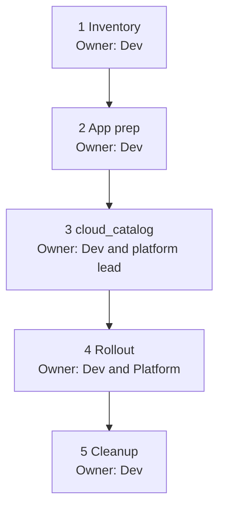

# Migration journey (five steps)

Same order as the [README](../README.md). Each step links to the full checklist in `docs/`.

---

## 1 — Inventory

**Owner:** Dev  

You list every Amplify env var and setting. You label each as plain config, secret, build arg, or drop. You mark unknowns instead of guessing.  

**Done when:** The inventory table is complete and linked from a PR. Details: [docs/01-inventory.md](../docs/01-inventory.md).

---

## 2 — App prep

**Owner:** Dev  

You add a Dockerfile, health check route, security headers in the app, and `deploy/k8s` values files. ECR and Sceptre names must match `${name}-${region}-${env}` on the first PR. You create **Secrets Manager** entries (values stay out of git).  

**Done when:** CI passes, values YAML is ready, and SM key names match `externalSecret` in git. Details: [docs/02-app-prep.md](../docs/02-app-prep.md).

---

## 3 — Platform registration

**Owner:** Dev opens the PR; **platform lead** reviews  

You add Argo and Tekton entries in **cloud_catalog** only. Tekton can run before Argo is turned on. You do not put secrets in this PR.  

**Done when:** Tekton can build on push; Argo app exists (often disabled until image + secrets exist). Details: [docs/03-platform.md](../docs/03-platform.md).

---

## 4 — Rollout

**Owner:** Dev and **Platform**  

You run INT first: Tekton build, Argo sync, smoke tests. Platform handles ingress, DNS, and IRSA when needed. PROD follows the same pattern after soak.  

**Done when:** Argo is Synced and Healthy, smoke tests pass, and DNS points at the new path when cut over. Details: [docs/04-rollout.md](../docs/04-rollout.md).

---

## 5 — Cleanup

**Owner:** Dev  

After soak, you remove `amplify.yml` and related Amplify docs from the app repo. Platform retires the Amplify app when rollback is no longer needed.  

**Done when:** Amplify files are gone on the live branch and EKS is the only host. Details: [docs/05-cleanup.md](../docs/05-cleanup.md).