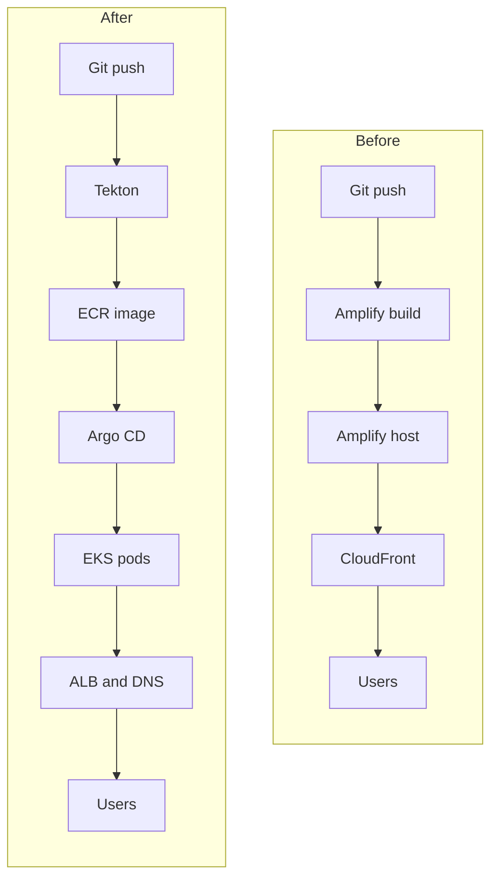

# Overview

You are moving a web app from **AWS Amplify** (build and host in one place) to **Kubernetes on EKS** (containers, built by **Tekton**, deployed by **Argo CD**).

Terms you do not know? See [glossary](glossary.md).

---

## What changes for the team

| Area | On Amplify today | On EKS after migration |
| --- | --- | --- |
| Build | Amplify runs `npm build` in its pipeline | **Tekton** builds a **Docker** image with **Kaniko** |
| Config | Env vars in Amplify console | Plain values in git; secrets in **Secrets Manager** |
| Client config | Often Amplify env | **NEXT_PUBLIC_** vars baked in at image build |
| HTTP / TLS | Amplify + **CloudFront** | **ALB** + Platform **DNS** (when ingress is enabled) |
| Deploy trigger | Push to connected branch | Push to Tekton branch + **Argo** sync |

---

## Before and after (traffic path)

---

## Where to read next

1. [Journey](journey.md) — five steps, who does what  
2. [How a deploy works](how-a-deploy-works.md) — build and rollout flow  
3. [Glossary](glossary.md) — short definitions  

Checklists and PR detail live under [`docs/`](../docs/).

## Further reading

[Kubernetes Application Onboarding Guide](https://yoyogroup-com.atlassian.net/wiki/spaces/~7120201b205b083b424b22835be38766bee0da/pages/1852702721/Kubernetes+Application+Onboarding+Guide) — Kubernetes Application Onboarding Guide (Cloud Platform, Confluence): general guide to taking any app from a Git repo to a validated deployment on the YoYo Kubernetes platform with Tekton, Helm, Argo CD and yoyo-cloud. Still a draft pending Cloud Platform approval. This playbook covers the Amplify-specific parts.